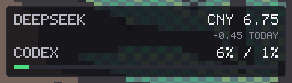

# AiMeter

> A tiny, pixel-art desktop widget for Windows 11 that keeps an eye on your AI
> service balances and quotas — **~16 MB working set, 0% idle CPU, no GPU, no web view**.

一个用 Win32 + 手写像素渲染实现的桌面小组件，常驻在桌面层，
实时显示 DeepSeek 余额与今日消耗、本机 DSH 的今日 token 用量，
以及 Codex（ChatGPT Plus）的 5 小时 / 每周额度。

同时，项目把这次实现里可复用的部分抽成了一个小框架（`src/widget`）：
**新增一个同类组件 = 一个数据结构 + 四个小函数**，窗口、托盘、热键、拖动、
配置持久化、定时刷新和工作线程都由框架负责。



## 特性

- **极低开销**：私有内存约 3 MB，工作集约 16 MB，空闲时 CPU 与 GPU 均为 0
- **零依赖渲染**：不用 Direct2D、不用 DirectWrite、不加载任何字体文件。
  一个 DIB 缓冲区 + 手写 5×7 点阵字体，逐像素写入
- **永远在桌面层**：窗口固定在 z 序最底部（紧跟 `Progman` 之上），
  不会盖住任何应用窗口，也永远不会抢焦点
- **点击穿透**：默认穿透，鼠标事件直接落到桌面；`Ctrl+Alt+W` 进入编辑模式后可拖动
- **系统托盘**：右键菜单提供刷新、设置、开机自启、退出
- **位置记忆 / 开机自启**：位置与组件自己的状态存在 exe 同目录的 `<id>.ini`
- **单实例**：重复启动会直接退出
- **不阻塞消息循环**：网络请求在 worker 线程里跑，界面先画缓存再刷新
- **本地 token 视图**：从 DSH 会话缓存读取今日 input / cache / output token，
  `Ctrl+Alt+D` 查看明细；不联网、不上传

## 支持的服务

| 服务 | 数据来源 | 状态 |
|---|---|---|
| DeepSeek | `GET https://api.deepseek.com/user/balance` + 本机 DSH 会话日志 | ✅ 余额 + 今日消耗 + 本机 token |
| Codex / ChatGPT Plus | 本地 `~/.codex/sessions/**/rollout-*.jsonl` 中的 `rate_limits` | ✅ 5h / 周额度百分比 |
| Z.AI Coding Plan | ZCode 内部 RPC，无公开接口 | ⏸ 代码中预留开关，默认隐藏 |

Codex 的额度**完全离线读取**，不产生任何网络请求：每次你使用 Codex CLI，
它会把 `primary`（5 小时窗口）和 `secondary`（每周窗口）的 `used_percent`
写进会话日志，AiMeter 只读最新那一条。

DeepSeek 的余额接口只有钱，没有 token。AiMeter 的 token 数来自
`~/.dsh/storages/session_projcache` 里的会话统计，因此口径是
**本机 + DSH**，不是账户总量；界面统一标成 `LOCAL`，不会和账户级花费混在一起。
设计探索（当前实现为 A 紧凑版）：[token 布局示意](docs/design/deepseek-token-layouts.png)。

## 框架：新组件 = 一个数据结构和四个函数

宿主（`src/widget/host.cpp`）提供：单实例、桌面层窗口、托盘、全局热键、
点击穿透 / 编辑拖动、位置与状态持久化、开机自启、定时刷新、后台线程、
以及一个像素风的输入框。组件只需要描述**数据从哪来**和**长什么样**：

```cpp
struct ClockData { std::wstring time; };

class Clock : public wg::WidgetT<ClockData> {
    wg::Desc Describe() override { return {L"clock", L"Desktop Clock", 220}; }
    void LoadData(ClockData& d) override { /* UI 线程，只跑一次 */ }
    void RefreshData(ClockData& d) override { /* worker 线程，可以阻塞 */ }
    int  HeightOf(const ClockData&) const override { return 78; }
    void PaintData(const ClockData& d, wg::Canvas& c) override { /* UI 线程 */ }
};
```

`WidgetT<Data>` 自带双缓冲：`RefreshData` 只写 staging，`PaintData` 只读
shown，两者不会同时执行，所以组件代码里不需要任何锁。

### 写一个新组件

```bat
powershell -ExecutionPolicy Bypass -File tools\new-widget.ps1 -Name weather
rem 编辑 src\widgets\weather\weather.cpp 里的 RefreshData / PaintData
cmd /c build.bat
build\bin\weather.exe
```

完整说明（生命周期、线程模型、API 速查、约定与坑）见
[docs/framework.md](docs/framework.md)。

## 目录结构

```
src/widget/            框架，编译成 build\libwg.a
  canvas.*             像素画布、5×7 字体、主题、面板/进度条
  view.*               标准 “标签 / 数值 / 进度条” 列表
  widget.h             Widget 契约 + WidgetT<Data> 双缓冲
  host.*               窗口、托盘、热键、拖动、持久化、定时器、worker
  store.*              exe 同目录的 UTF-16 key=value 配置
  http.*               WinHTTP GET
  secrets.*            Windows 凭据管理器
  prompt.*             像素风单行输入框
src/widgets/aimeter/   现有组件 + DeepSeek / Codex / DSH token 数据源 + 明细面板
src/widgets/clock/     最小示例（无网络、无配置）
tests/render.cpp       无窗口渲染测试（产出 BMP）
tools/new-widget.ps1   脚手架
build.bat
docs/
legacy/app.cpp         旧版单文件实现，仅作对照，不参与构建
```

## 构建

需要 **MinGW-w64 GCC**（开发时使用 WinLibs GCC 16.2.0，UCRT + POSIX 线程）
和 Windows 10/11 x64。

```bat
build.bat        rem 框架 + 所有组件 -> build\bin\*.exe
build.bat test   rem 额外跑无窗口渲染测试 -> build\preview.bmp
```

`build.bat` 默认从 `C:\Tools\mingw64\bin` 找 `g++`，改顶部 `TOOLROOT` 即可。
所有中间文件和产物都在 `build\` 下，并且故意使用**相对路径**：
MinGW 的汇编器无法处理非 ASCII 路径（例如中文用户名 / 中文目录）。

产物：`build\bin\aimeter.exe`（约 1.3 MB）和 `build\bin\clock.exe`，
静态链接，无运行时依赖。旧版放在仓库根目录的 `aimeter.ini` 会被
`build.bat` 一次性复制到 `build\bin\`，位置不会丢。

## 使用

| 操作 | 说明 |
|---|---|
| `Ctrl+Alt+W` | 切换编辑模式（可拖动、右键菜单） |
| `Ctrl+Alt+D` | 打开/关闭 token 明细（也可用托盘 Details...） |
| `Ctrl+Alt+Q` | 退出 |
| 托盘图标双击 | 同 `Ctrl+Alt+W` |
| 托盘右键 | 刷新 / 设置 / 详情 / 开机自启 / 退出 |

### 配置 API Key

`Ctrl+Alt+W` → 右键 → **Settings...**，粘贴 DeepSeek 的 API key 回车即可。

- key 通过 `CredWriteW` 存入 **Windows 凭据管理器**，目标名 `AiMeter/DeepSeek`，
  不落任何明文文件
- 查询余额是只读接口，不消耗 token、不扣费
- 换 key 时重新打开设置窗输入新的即可

### 配置文件

`build\bin\aimeter.ini`（与 exe 同目录，UTF-16 编码）：

```ini
x=2240          ; 窗口位置（框架写入）
y=1300
day=2026-10-20  ; 当日快照日期（组件写入）
start=720       ; 当天开局余额（分）
last=687        ; 最近一次余额（分）
```

“今日消耗” = `start - 当前余额`。跨天时把 `last` 当作新一天的开局值，
所以即使深夜没开机，第二天也能算出准确差额。

token 快照另存为 `tok.day` / `tok.sum`（按 input / cache read / cache write /
output 四个桶累计）以及每个会话的 `tok.s.<session-id>`，由组件维护，一般不用手改。

## 为什么不用 Direct2D

第一版用 D2D 的 DC 渲染目标实现，功能正常，但**私有内存 51 MB**——
D2D 在 DC 目标上会拉起软件光栅化设备，光它一个就吃掉 40 MB。
改成“自己往 DIB 写 BGRA + `UpdateLayeredWindow`”之后降到 **2.9 MB**，
顺带砍掉了 D2D/DWrite 的 DLL 依赖，启动也更快。

像素风本身不需要抗锯齿和亚像素排版，这正好让“最省”和“最像”重合。

## 已知限制

- 点阵字体只有 ASCII（5×7）。中文、emoji 会显示为空白；需要时得换字体源
- token 只统计**本机 DSH** 的调用，其他客户端/其他机器的用量不计入；
  余额接口也没有账户级 token 汇总
- 仅支持单显示器（主屏右下角，可拖动），固定像素，不随 DPI 缩放
- 每个组件是一个独立进程（多组件共用一个宿主还没做）
- 全局热键默认 `Ctrl+Alt+W/Q/D`，同时运行多个组件会互相抢注册，
  可在 `wg::Options` 里改
- 面板是普通顶层窗口，`Win+D`（显示桌面）会把它一起隐藏
- Z.AI 行暂未启用

## License

[MIT](LICENSE)
