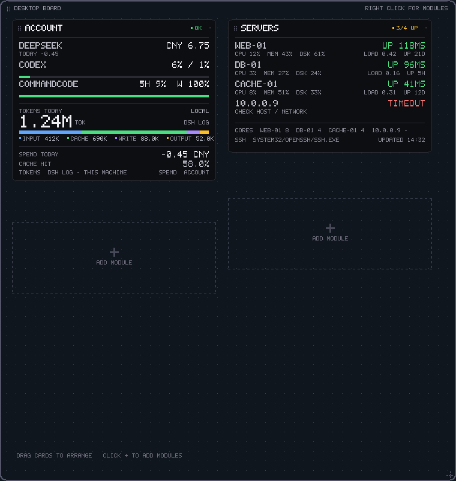
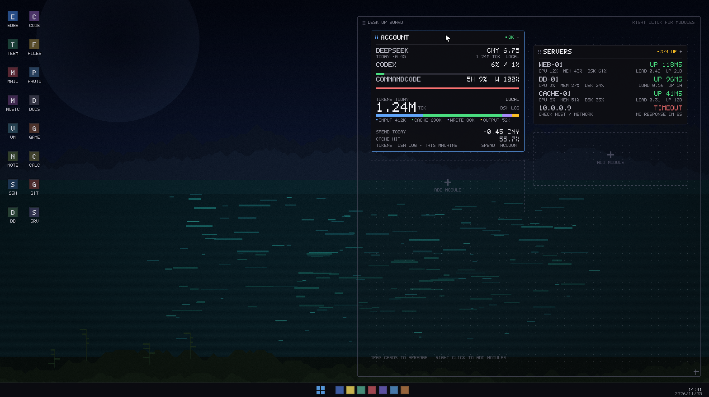

# Desktop Board（desk.exe）

> 一块常驻桌面层的**洞洞板**：一个进程、一块板、若干可自由摆放的模块卡片。
> 当前模块：**AiMeter**（DeepSeek / Codex / CommandCode / 本机 token）、
> **Server Status**（SSH 服务器状态）和 **PowerShell**（常驻 pwsh 控制台）。
> 约 **20 MB 工作集、空闲 0% CPU、不抢焦点、始终置底**（PS 卡另带一个常驻
> pwsh 子进程，见下文）。



## 它是什么

- **一块板**：默认占据屏幕右侧 760×800（可按工作区缩放），半透明点阵玻璃，
  可拖动、可缩放，始终压在普通窗口之下。
- **多张卡**：每个模块是一张独立卡片，拖动标题条自由摆放；8px 吸附，松手时
  如果压到别的卡片会自动落到最近空位。
- **内联详情**：点卡片标题条右侧的 `+`/`-` 就地展开，不再有第二个弹窗。
- **可增删**：右键板标题条或托盘 → Add module / Tidy board / Refresh / Exit；
  卡片菜单里有 Settings / Details / Refresh / Remove card。
- **不整窗穿透**：卡片和板面控件始终接收鼠标；**没有卡片的空白点**交给桌面，
  桌面图标照常可点。`board.solid=1` 可以改成整块板都接收点击。
- **置底不抢焦点**：点击卡片不会改变当前前台窗口；菜单/设置输入框只在自己的
  窗口里取焦点。
- **一套视觉**：板面/卡片/行/详情全部由 `src/widget/skin.*` 的令牌和原语
  绘制；板面 2px 边框 + 10px 像素圆角，卡片 1px + 6px，新增模块自动融入。
- **拖动节拍**：高精度时钟按 60 fps 调度，不再被 15.6ms 系统 tick 压到约 32 fps；
  松手落盘在后台线程，不阻塞 UI。

整屏设计稿（壁纸上的比例参考；实际边框/圆角以当前渲染为准）：



## 产物

| 产物 | 说明 |
|---|---|
| `desk.exe` | 洞洞板 + Account / Servers / PowerShell 卡片 |
| `srvctl.exe` | 命令行搭档：status / exec / ssh / hosts / doctor |
| `archive/` | 旧 aimeter/server/sshpad/clock、AI Mini、旧 host 框架和旧 exe；只作参考，不再构建 |

## 快速开始

```bat
build.bat
powershell -ExecutionPolicy Bypass -File tools\sign-local.ps1 -Path build\bin\desk.exe
build\bin\desk.exe
```

- 第一次运行会创建 `build\bin\desk.ini`，把板子放在右侧，并移除旧的
  `AiMeter` / `Server Status` / `SSH Pad` 自启项、设置 `Desktop Desk` 自启。
- 右键**板标题条**（顶部 `DESKTOP BOARD` 那一行）或托盘图标打开板菜单。
- 右键**卡片标题条**打开卡片菜单。

## 操作

| 操作 | 说明 |
|---|---|
| 拖卡片标题条 | 移动卡片；标题条右侧 28px 是 `+`/`-` 展开按钮，不参与拖动 |
| 拖板标题条 | 移动整块板 |
| 拖板右下角 | 缩放板；最小 400×420，最大当前显示器工作区 |
| 左键卡片标题条右侧 `+`/`-` | 展开/收起该卡片详情 |
| 左键 PS 卡命令行区域 | 把键盘交给这张卡，接着就能直接打字（光标闪在输入行） |
| 右键卡片 | 模块菜单（`Type here` / Settings 等）、Details、Refresh、Remove card |
| 右键板标题条 / 托盘 | Add module、Tidy board、Refresh all、Show grid、Empty area passes clicks、Start with Windows、Exit |
| 左键虚线 `ADD MODULE` 槽 | 打开同一个板菜单 |
| `Ctrl+Alt+W` | 打开板菜单 |
| `Ctrl+Alt+R` | 刷新所有卡片 |
| `Ctrl+Alt+D` | 展开/收起所有可展开的卡片 |
| `Ctrl+Alt+Q` | 退出 |
| 托盘双击 | 同 `Ctrl+Alt+D` |

卡片位置、展开状态、板的位置和尺寸都存在 `desk.ini`；下次启动原样恢复。

## 当前模块

### Account（AiMeter）

| 数据 | 来源 | 状态 |
|---|---|---|
| DeepSeek 余额 / 今日消耗 | `GET api.deepseek.com/user/balance` + 本机快照 | ✅ |
| Codex / ChatGPT Plus 5h / 周额度 | 本地 `~/.codex/sessions/**/rollout-*.jsonl` 的 `rate_limits` | ✅ 完全离线 |
| CommandCode 5h / 周额度 | `GET api.commandcode.ai/alpha/billing/credits` | ✅ |
| 本机 DSH token | `~/.dsh/storages/session_projcache` | ✅ 标成 `LOCAL` |

- 刷新 300s；收起高 144px，展开高 269px。
- 卡片菜单：`DeepSeek API Key...`、`CommandCode API Key...`；key 存在 Windows
  凭据管理器（`AiMeter/DeepSeek`、`AiMeter/CommandCode`），不落明文文件。
- CommandCode 没手动设置时自动回退到 `~/.dsh/.credentials.yaml` 的
  `COMMANDCODE_API_KEY`。
- 详情里的 token 只统计**本机 DSH**，界面标 `LOCAL`，不和账户余额混算。

### Servers（Server Status）

- 每台一行：在线状态 + 往返耗时，CPU / 内存 / 根分区 / 负载 / uptime。
- 通过本机 OpenSSH 和已有 key 读远端 `/proc`、`df`，不装 agent。
- 刷新 30s；最多 8 台；每台一次只读探测，单台 8s 超时，互不拖累。
- 卡片菜单：`SSH Hosts...`，写回 `server.ini` 的 `hosts=`；
  `srvctl status` / `srvctl hosts` 读同一份配置，改完立即生效。
- 展开详情补充失败错误、`CORES`、SSH 客户端路径和 `UPDATED`，不重复行内指标。

状态值：`UP 120MS` / `TIMEOUT` / `AUTH` / `DNS` / `REFUSED` / `HOSTKEY` /
`NO SSH` / `NO DATA`。绿色 < 75%，黄色 ≥ 75%，红色 ≥ 90%。

详细配置、探测脚本和排错见 [docs/server.md](docs/server.md)。

### PowerShell（PS 控制台）

一张常驻的 pwsh 卡：启动时拉起一个长驻 shell，**点一下卡片的命令行区域就能直接打字**，
输出（stdout + stderr）实时滚到卡面上，`cd` / 变量 / 导入的模块都跨命令保留。

- shell 解析顺序：`ps.ini` 的 `shell=` → `%PWSH_EXE%` → PATH 上的 `pwsh`
  → `%ProgramFiles%\PowerShell\7\pwsh.exe` → `L:\powershell\pwsh.exe`
  → 5.1 的 `System32\WindowsPowerShell\v1.0\powershell.exe`。
- 以 `-NoLogo -NoProfile -NonInteractive -NoExit -Command -` 运行：
  不加载 profile、不打印 banner；`Read-Host` / `-Confirm` 会**直接报错**而不是
  把卡片挂住。工作目录是 `%USERPROFILE%`（像终端一样从用户目录起步）。
- 输入：`Enter` 执行、`↑`/`↓` 历史、`←`/`→`/`Home`/`End` 移动光标、
  `Backspace`/`Delete`、`Ctrl+V` 粘贴、`Ctrl+L` 清屏、`Esc` 清空当前行。
  打字时输入行前面是绿色 `>` 和蓝色光标，执行后自动清空等下一条。
- 选中：在正文上**按住左键拖动**即可选中（蓝色高亮，可跨行，新输出不会让选中错位）；
  `Ctrl+C` 有选中就复制、没选中就清当前行，`Ctrl+A` 全选可见行。
- 卡片菜单：`Type here`（鼠标不在卡上时也能拿键盘）、`Run system test`（一行体检：
  PS 版本 / 主机名 / 已开机小时 / C: 剩余 / 当前目录）、`Clear log`、`Restart shell`。
- 焦点：**只有点中这张卡的命令行区域，板才拿键盘**；其余位置照旧不抢焦点。
  拿到键盘后板仍贴在最底层，点别处 / 开菜单 / 失去焦点立刻释放。
- 收起 6 行、展开 14 行；超长行按卡片宽度截断（终端语义，不折行）；
  缓冲保留最近 500 行。
- 输出不做定时轮询：读线程收到新行才请求重绘，空闲时不占 CPU。

状态值：`PWSH 7.6`（运行中，绿）/ `NO SHELL`（找不到或启动失败，红）/
`EXITED`（shell 已退出，红，`Restart shell` 恢复）。

## 配置

配置文件都在 exe 同目录；目录不可写时回退到 `%APPDATA%\Desktop Desk`。

`desk.ini`（UTF-16 key=value）：

```ini
board.x=784
board.y=24
board.w=760
board.h=800
board.grid=1          rem 1 = 显示点阵
board.solid=0         rem 1 = 整块板接收点击（默认空白点交给桌面）
card.account.x=20
card.account.y=32
card.account.visible=1
card.account.expanded=0
card.servers.x=380
card.servers.y=32
card.servers.visible=1
card.servers.expanded=0
card.ps.x=392
card.ps.y=128
card.ps.visible=1
card.ps.expanded=0
```

模块自己的数据仍在原来的文件里：`aimeter.ini`（余额快照、token 快照）、
`server.ini`（hosts/ssh/key/timeout）、`ps.ini`（`shell=` 显式路径、
`autostart=0` 推迟到第一条命令才拉起 shell）。旧文件不需要迁移。

**不要和新旧组件同时运行**：新旧都会更新同一份 `aimeter.ini` 快照；首次运行
会清掉旧的失效自启项，并写 `Desktop Desk`。

## 新增一个模块

```bat
powershell -ExecutionPolicy Bypass -File tools\new-panel.ps1 -Name weather -Title WEATHER
rem 编辑 src\panels\weather\weather.cpp 的 RefreshData / PaintBodyOf
rem 在 src\apps\desk\main.cpp 的 CreateModules() 里加一行：
rem   modules.push_back(CreateWeatherModule());
build.bat
```

模块契约只有六个函数：

```cpp
struct WeatherData { std::vector<wg::Row> rows; };

class WeatherModule : public wg::ModuleT<WeatherData> {
public:
    wg::ModuleSpec Describe() const override {
        return wg::ModuleSpec{L"weather", L"WEATHER", L"weather.ini", 340, 600, false, false, {}};
    }
protected:
    void LoadData(WeatherData&) override { ... }
    void RefreshData(WeatherData& data) override { ... }   // worker 线程，可阻塞
    int  BodyHeightOf(const WeatherData& data) const override {
        return wg::skin::RowsHeight((int)data.rows.size());
    }
    void PaintBodyOf(const WeatherData& data, wg::Canvas& c, const wg::Rect& body) override {
        wg::skin::Rows(c, body, data.rows, theme_);
    }
private:
    wg::Theme theme_;
};
```

- `RefreshData` 只写 staging，`PaintBodyOf` 只读 shown，Board 保证不同时执行，
  所以模块里不需要锁。
- 卡片宽 340 / 标题条 30 / 内边距 12 / 行距 32 由 `skin` 统一；模块只画 body，
  不画外框、不建窗口。
- 新模块自动出现在 **Add module** 菜单里；位置/展开状态由 Board 持久化。
- 完整契约、视觉规范和测试见 [docs/desk.md](docs/desk.md)。

## srvctl（命令行）

`srvctl.exe` 保持独立：脚本、CI、一次性远程命令用它，桌面卡片回答“现在怎么样”。
两者共用 `src/data/server/providers.cpp` 和 `server.ini`，状态码/超时/探测脚本
完全一致。

```bat
build\bin\srvctl.exe status
build\bin\srvctl.exe exec web-01 -- uptime
build\bin\srvctl.exe hosts add db-01
build\bin\srvctl.exe doctor
```

完整命令、JSON schema 和退出码见 [docs/cli.md](docs/cli.md)。

## 归档

旧的 aimeter / server / sshpad / clock、旧 `Widget/Host` 框架、AI Mini 实验、旧测试/
脚手架和旧 exe 已移到 `archive/`，不参与 `build.bat`；清单和恢复方法见
[archive/README.md](archive/README.md)。

## 构建与测试

需要 **MinGW-w64 GCC**（开发时 WinLibs GCC 16.2.0，UCRT + POSIX 线程）和
Windows 10/11 x64。

```bat
build.bat            rem 框架 + desk.exe + srvctl.exe
build.bat test       rem 额外跑无窗口测试，产出 build\preview.bmp / desk-board-preview.bmp 等
```

- 所有中间文件和产物都在 `build\` 下，故意使用相对路径：MinGW 汇编器无法处理
  非 ASCII 路径（例如中文用户名/目录）。
- `build.bat test` 在跑测试前用 `tools\sign-local.ps1` 给测试 exe 签名；如果
  证书无法创建，脚本会失败，可以先手动运行 `tools\sign-local.ps1`。
- **Windows 11 Smart App Control**：新构建的 exe 会被拦截，运行
  `powershell -ExecutionPolicy Bypass -File tools\sign-local.ps1`
  用当前用户的自签名证书重签即可（无需管理员、不上传；重建后要重签）。

## 性能（本机实测）

同一台 Windows 11 机器，2026-11-05，板 760×800，Account 收起 / Servers 1 台：

| 指标 | desk.exe | 旧 aimeter + server |
|---|---|---|
| 进程 / 窗口 / 托盘 / 定时器 | 1 / 1 / 1 / 1 | 2 / 2 / 2 / 2 |
| 工作集 | 约 19.9–20.4 MB | 约 32 MB |
| 私有内存 | 约 5.1 MB 空闲 / 6.4 MB 刷新中 | 约 6 MB |
| 线程 | 7 空闲 / 11 刷新中（含后台保存线程） | 各自 2–4 |
| GDI / USER 对象 | 9 / 6 | 各自一套 |
| 空闲 CPU | 10s 内 0 ms | 各自 0% |

统一收益：一个 UI 线程、一个令牌/字体缓存、一个 WinHTTP/SSL 栈、一个托盘、
一个自启项、一套热键、一张 DIB。拖动卡片只移动板内矩形，不创建/移动 HWND。

## 目录

```
src/apps/desk/main.cpp      注册模块（一行一个）
src/panels/account/         Account 卡片 + 视图
src/panels/servers/         Servers 卡片 + 视图
src/panels/ps/              PowerShell 卡片 + 控制台视图（内联输入）
src/widget/board.*          洞洞板宿主：窗口、调度、拖动、菜单、托盘、键盘焦点、持久化
src/widget/board_layout.*   纯布局：吸附、避让、命中测试
src/widget/skin.*           板面/卡片/行/详情/控制台/Add 槽的视觉令牌
src/widget/module.h         Module / ModuleT<Data> 契约（含键盘钩子）
src/widget/geom.h           Rect
src/widget/appenv.*         配置目录、自启
src/widget/                 其余框架（canvas/cjk/view/layout/store/http/secrets/prompt/proc）
src/data/                   共享数据源（aimeter / server / ps）
src/cli/                    srvctl
archive/                    旧组件/实验/文档/二进制（不参与构建）
tests/board_layout.cpp      布局/裁剪/命中的无窗口测试
tests/desk_render.cpp       整板渲染测试（BMP）
tests/ps_tests.cpp          解码/ANSI/切行/行编辑器 + 常驻 shell 端到端测试
tools/new-panel.ps1         新模块脚手架
tools/bench-desktop.ps1     资源/空闲 CPU 采样
tools/sign-local.ps1        Smart App Control 下的本地签名
docs/desk.md                洞洞板/模块/视觉/配置完整说明
docs/server.md              Servers 卡片与共享探测的排错
docs/cli.md                 srvctl
archive/docs/sshpad.md      SSH Pad（已归档，不构建）
```

## 已知限制

- 单显示器、固定像素、不随 DPI 缩放；板的位置/尺寸在 `desk.ini`。
- 空白板面默认把点击交给桌面，所以**板菜单在标题条/托盘/Add 槽上**，不是空白
  处；要整板接收点击把 `board.solid` 设为 1。
- 一个模块类型只放一张卡；卡片宽度由模块声明，不支持自由缩放；卡片比板高时
  会被裁切，先放大板。
- `Win+D`（显示桌面）会把板一起隐藏（普通顶层窗口的既有行为）。
- 退出时如果 SSH 探测在飞，最多等一个 8s 探测超时。
- Servers 只支持 Linux 目标（读 `/proc`），最多 8 台；`srvctl` 最多 32 台。
- CommandCode 使用未公开的 `/alpha` 接口，字段变化时该行显示 `NO DATA`。
- PS 卡带着一个常驻子进程：pwsh 7 空闲约 **99 MB 工作集 / 27 线程**（5.1 约
  72 MB）。想省内存把 `ps.ini` 设 `autostart=0`，第一条命令时才会拉起。
- PS 卡要先点中卡片的命令行区域才收键盘；这一刻板会被激活（仍贴底，不改变前台
  窗口的可见顺序），点别处 / 开菜单即释放。它没有滚轮回滚，只保留最近 500 行；
  选中按当前可见的行取文本；超长行按宽度截断；命令必须自己结束（`Read-Host` 会
  报错，后台任务请用 `Start-Job`）；输出用 5×7 像素字体，所以**只有大写**。
- 不并入 SSH Pad / Clock / AI Mini；它们已归档在 `archive/`，不再构建；需要时按
  `Module` 契约重新接入。
- Smart App Control 开启时（本机 `VerifiedAndReputablePolicyState=1`），重建的 exe
  要用 `tools\sign-local.ps1` 重签；自签根证书不在信任库里，SAC 仍可能拦住新
  hash。若被拦，见 `docs/desk.md` 的排错一节。
- 新旧组件不要同时运行（共享 `aimeter.ini` 的当日快照）。

## License

[MIT](LICENSE)
