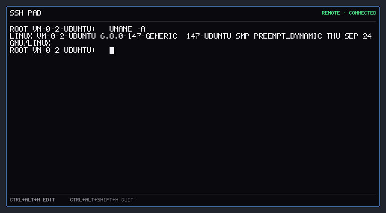

# SSH Pad（sshpad.exe，已归档）

> **已归档（2026-11-05）**：SSH Pad 不再构建，也不在 `desk.exe` 的洞洞板里。
> 源码在 `archive/standalone/sshpad`，旧 exe 在 `archive/bin/sshpad.exe`。
> 需要终端卡时按 `Module` 契约重新接入（需要更宽的板，另行评估）。


一个常驻桌面层的 **SSH 终端组件**：终端在组件内部，不打开新的控制台窗口。
它直接显示远程 shell 的屏幕内容，点击面板即可输入。



## 工作方式

Windows 没有可嵌入的终端控件，所以 SSH Pad 采用“隐藏控制台 + 读屏”的方式：

1. 组件进程创建一个隐藏的控制台（窗口立即隐藏，不进任务栏）
2. 用 `ssh -tt` 在这个控制台里启动登录会话
3. 每 40ms 读取一次控制台屏幕缓冲区（没有变化就不重绘）
4. 用像素画布把字符、颜色、光标画到组件面板
5. 键盘输入通过控制台输入队列注入，密码 / passphrase 也由 ssh 正常处理

这样终端、颜色、光标、全屏程序都交给 Windows 控制台处理，组件本身不解析
ANSI，也不启动可见的 console。代价是每个组件会有一个隐藏的 conhost 进程。

## 快速开始

```bat
archive\bin\sshpad.exe
```

启动后默认**自动连接 `server.ini` 里的第一台主机**，所以打开就是远程 shell：

1. 用鼠标点击终端区域（获得焦点）
2. 直接输入命令，回车执行
3. `Ctrl+Alt+1..8` 切换主机；切换会结束当前会话并连接新主机
4. `Ctrl+Alt+H` 进入编辑模式拖动面板，`Ctrl+Alt+Shift+H` 退出
5. 右键托盘可以 Connect / Settings / Refresh / Start with Windows / Exit

不想启动即连接，在 `sshpad.ini` 里加一行：

```ini
auto=0
```

这样启动后显示主机菜单，点击某一台或按 `Ctrl+Alt+1..8` 再连接。

## 界面

```text
SSH PAD                              REMOTE - CONNECTED
root@web-01:~# uname -a
Linux web-01 6.8.0-45-generic #45-Ubuntu ...
root@web-01:~# _
CTRL+ALT+H EDIT   CTRL+ALT+SHIFT+H QUIT
```

- 终端固定 `80×24` 字符，组件尺寸约 `744×400`
- 右上角显示当前主机和 `CONNECTED` / `SESSION ENDED` / 错误
- 未聚焦时底部提示 `CLICK TO TYPE`；聚焦后显示编辑/退出热键
- 断开后保留最后一屏内容，按热键可重新连接
- 没有主机时显示 `NO SSH HOSTS / EDIT SERVER.INI`

## 操作

| 操作 | 说明 |
|---|---|
| 点击终端区域 | 获得键盘焦点，开始输入 |
| `Ctrl+Alt+1..8` | 连接/切换到第 1..8 台主机 |
| `Ctrl+Alt+H` | 编辑模式（可拖动、右键菜单） |
| `Ctrl+Alt+Shift+H` | 退出组件 |
| 托盘右键 | Connect / Settings / Refresh / Start with Windows / Exit |
| `Settings...` | 编辑 `server.ini` 的 `hosts=`，和 Server Status 共用 |

鼠标点击主机菜单中的一行也可以连接。主机切换会终止当前 `ssh` 子进程，重新
建立会话；不会在后台保留多个连接。

## 配置

SSH Pad 只读 `server.ini`（和 `server.exe` 同目录）：

```ini
hosts=web-01, db-01, root@10.0.0.5
ssh=
key=
```

- `hosts`：逗号 / 分号 / 空格分隔，最多 8 台
- `ssh`：可选，指定 `ssh.exe`；留空则用系统 OpenSSH / `PATH`
- `key`：可选，追加为 `ssh -i <path>`
- `auto`：写在 `sshpad.ini`，`1`（默认）启动即连接第一台，`0` 显示主机菜单

`Settings...` 会写回 `server.ini` 的 `hosts`。Server Status 下一轮刷新会重新读取
这三个共享键；同时编辑时以最后一次保存为准。

SSH Pad 连接时使用 `-tt`，远端 shell 会拿到一个真正的 TTY；密码认证、`sudo`
提示、`tmux`、`vim`、`top` 都由远端 PTY 和控制台处理。认证优先使用
`~/.ssh/config`、key 和 ssh-agent。

## 性能

本机（Windows 11，80×24 终端，auto=1，空闲 shell）实测：

| 指标 | 组件进程 | 说明 |
|---|---|---|
| 私有内存 | 约 2.9–3.3 MB | 隐藏控制台 + DIB + 终端状态 |
| 工作集 | 约 12–16.6 MB | 与现有组件同一量级 |
| 空闲 CPU | ≈ 0–0.1% | 40ms 轮询，屏幕无变化时只读不画 |
| 启动 | < 1 s | 不含 SSH 握手 |
| 额外进程 | 1 个隐藏 conhost + 1 个 ssh | ssh 只在会话期间存在 |
| 常驻定时器 | 无 | 连接后才启动读屏线程 |

- 没有连接时：只有静态面板 + 一次配置读取，不产生网络请求
- 连接后：40ms 读一次 80×24 控制台缓冲区；内容变化才 `RequestRepaint`
- 不解析 ANSI，不做逐帧合成；颜色/光标由控制台状态直接映射
- 关闭会话或退出组件时终止 `ssh` 并释放隐藏控制台

## 限制

- 终端固定 `80×24`，没有内建滚动条；长输出用远端 `less` / `tmux`
- 一次只维持一个会话；切换主机会结束当前会话
- 点阵字体只覆盖 ASCII；非 ASCII 控制台字符显示为 `?`
- 不做文件上传/下载、端口转发、批量执行
- 隐藏控制台依赖 Windows conhost；仅 Windows 10/11
- 组件在桌面层，点击聚焦后可能短暂到前台；点击其他窗口后会回到桌面层
- 全局热键可能和其他软件冲突；托盘 Connect 菜单始终可用
- Windows 11 Smart App Control 开启时，新链接的 `sshpad.exe` 需要
  `tools\sign-local.ps1` 重签

## 构建与测试

归档后不再由 `build.bat` 构建；旧源码在 `archive/standalone/sshpad`，旧 exe 在
`archive/bin/sshpad.exe`。旧构建流程需要恢复 `archive/framework/host` 和
`archive/standalone/sshpad`；共享的主机解析仍在 `src/data/server/providers.cpp`。
