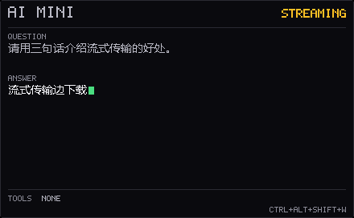
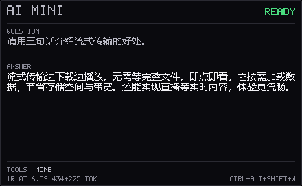

# AiMini：接入 API 的 AI 驱动最小系统（实验）

> 位置：`experiments/ai-mini`。这是在本仓库现有桌面组件框架上做的一次
> “最小 AI 系统”探索：**一句问题 → 模型决定调用哪个本地工具 → 执行 → 再问模型
> → 桌面像素窗口显示答案**。
>
> 对框架做了增量改动：`http.*` 的 `HttpPost` / `HttpPostStream`、`cjk.*` 的中文字形
> 缓存、`prompt.cpp` 的 Unicode 输入、`widget.h` + `host.cpp` 的 worker→UI 重绘钩子。
> 业务代码都在这个子目录里。
>
> 界面只保留一个 **440×272** 的面板（原来的小组件 + 明细窗口合并），
> 答案通过 SSE 增量显示。




## 结论先说

- **能跑通**：工具调用循环在真实模型上端到端可用，模型会自己决定调用
  `disk_free` / `local_time` / `system_info`，再把结果组织成一句回答。
- **DeepSeek 这条路径没有跑完**：本机 `~/.dsh/.credentials.yaml` 里的 key
  认证通过，但账户余额是 **-0.03 CNY**，接口返回 `402 Insufficient Balance`，
  AiMini 把它映射成 `NO CREDIT`（484 ms 返回）。余额接口
  `/user/balance` 也确认是 -0.03。
- **换一个 OpenAI 兼容端点就验证了完整链路**：用本机 Z.AI Coding Plan 的 key
  指向 `glm-4.6`，单工具、双工具、纯回答、错误 key 四条路径都实测通过。
- **中文可以完整走通**：输入框接受 UTF-16（`WM_CHAR` + `WM_PASTE`），问题以
  UTF-8 发给模型，模型按提问语言用中文回答，窗口用系统字体点阵渲染中文。
- **中文显示几乎不花性能**：单面板下工作集从 11,008 KB 到 11,072 KB
  （**+64 KB**），实渲染约 0.016 ms/帧，空闲 CPU 仍为 0；详见下文实测。
- **流式已经接入**：`stream: true` + SSE 增量解析，worker 每收到一段就请求 UI
  重绘；面板显示 `STREAMING` 和绿色光标。首 token 之后的输出不再等整包。
- **协议本身很薄**：一次 chat/completions 请求 + 一轮 tool 消息回填；
  流式只是同一请求的 `stream` 变体，不需要 SDK、不需要数据库。

| 实测 | 轮数 | 工具 | 耗时 | tokens |
|---|---|---|---|---|
| “C 盘剩多少空间？” | 2 | 1 | 9.0 s | 887 + 68 |
| “现在几点 + 内存占用？” | 2 | 2 | 5.8 s | 960 + 79 |
| “用五个词打个招呼” | 1 | 0 | 3.6 s | 415 + 77 |
| “我的 C 盘还剩多少空间？”（中文） | 2 | 1 | 6.6 s | 902 + 68 |
| “用三句话介绍流式传输”（中文，流式） | 1 | 0 | 6.5 s | 434 + 225 |
| “今天是星期几？”（中文，流式 + 工具） | 2 | 1 | 5.3 s | 891 + 61 |
| DeepSeek（余额不足） | 0 | 0 | 0.5 s | — |

> 时间：2026-11-05。模型返回的 `model` 字段是 `glm-5.3-flash`（coding plan
> 服务端路由），请求里写的是 `glm-4.6`，协议完全一致。

## 中文支持与性能（实测）

原来的限制有三层，不只是“字体没有中文”：

| 层 | 现象 | 改动 |
|---|---|---|
| 输入 | `PromptText` 的 `WM_CHAR` 只收 32–126，粘贴也只收 ASCII | 接受全部可打印 UTF-16；新增 `WM_PASTE`；IME 组合窗定位到光标 |
| 显示 | `Canvas::Text` 只有 5×7 ASCII 字形，非 ASCII 画成空格 | `src/widget/cjk.*`：14 px 系统字体字形缓存，1 bpp 掩码，按 `gmptGlyphOrigin` 对齐基线 |
| 回答 | 系统提示要求英文 + 纯 ASCII | 改成“与提问同语言，纯文本、≤45 词 / 80 字” |

关键设计：**ASCII 路径一行都没改**。`cjk::Text` 把连续 ASCII 片段交给
`Canvas::Text`，只有遇到汉字、假名或全角标点才创建字体、栅格化字形。只显示
英文的组件不会创建字体，也不会碰任何 CJK 页面；缓存上限 4096 个字形。

实测（同一台机器，2026-11-05，`ai-mini.exe` 单进程）：

| 场景 | 工作集 | 私有内存 |
|---|---|---|
| 仅显示英文（不调 API） | 11,008 KB | 2,184 KB |
| 仅显示中文（不调 API） | 11,072 KB | 2,196 KB |
| 实际 API + 流式（中文） | 20,816–21,536 KB | 3,800–4,000 KB |

- 显示层中文开销：**+64 KB 工作集 / +12 KB 私有内存**，在噪声范围内。
  单独测 140 个汉字：原始字形数据只有 6.7 KB，字体 + 缓存增量约 **+136 KB**；
  裸进程里连清屏渲染一起算，上界约 **+280 KB**，首次创建字体约 16 ms。
- 实际渲染基准（300×160，清屏 + 4 行中文，1000 帧）：
  **中文与英文都是 0.016 ms/帧**；空闲 10 秒 CPU 增量 **0 ms**。
- 真正占内存的是第一次 API 调用拉起的 WinHTTP/SSL 栈（约 +10 MB），
  中英文一样，与 CJK 无关。

为什么不用内嵌字库？GB2312 规模的 16×16 点阵约 250 KB，覆盖常用字但要处理
字体许可/署名，而且只能固定一个字号；系统字体缓存最坏约 0.3 MB，覆盖完整
Unicode、跟随系统字形。代价是依赖 Windows 中文字体（YaHei/SimSun）。要做
完全离线、零字体依赖的发行版时，把 `cjk::Font` 换成内嵌 Unifont 子集即可。

输入用真实控件验证（`build.bat prompttest`，直接驱动 `PromptText`）：

```text
mode=char  ok=1 text=我的 C 盘还剩多少空间？
mode=paste ok=1 text=我的 C 盘还剩多少空间？
```

## 流式：SSE + 增量重绘


一整包等回来再画的代价是“首 token 之后还在等”。现在同一请求改成：

1. **请求**：`stream: true` + `stream_options.include_usage`，`Accept: text/event-stream`
2. **传输**：框架新增 `wg::HttpPostStream`；WinHTTP 每读到一块就回调，
   成功路径不缓存整包（只留 256 KB 用于“服务端忽略 stream”的兜底）
3. **解析**：`llm::ChatStream` 按行读 `data:`，累积 `delta.content`；
   `delta.tool_calls` 按 `index` 拼 `id` / `name` / `arguments`，工具轮次仍是完整 JSON
4. **绘制**：worker 每收到一段就锁内追加 `streamText_`，调用 `RequestRepaint()`；
   host 收到 `WM_APP+3` 后在 UI 线程重绘，画出 `STREAMING` + 绿色光标
5. **收尾**：流结束的 `Result` 与阻塞版同形，agent 的工具循环一行没改

流式解析对中文是安全的：SSE 的每个 `content` 是完整 UTF-8 字符串，不会在
多字节字符中间切开。

实测（`glm-4.6`）：

```text
[model ] glm-4.6 streaming (0 ms)
流式传输是指数据（如音视频）边下载边播放的技术，无需等待整个文件下载完成即可连续观看或收听。

1 round(s), 0 tool call(s), 10.4s, 432+84 tokens, first token 9734ms
```

**要诚实地说**：GLM 的“首 token”经常在 5–10 秒，因为它在隐藏推理；流式只能
消除首 token 之后的等待，不能把推理时间变没。DeepSeek 等非推理模型的首 token
会短很多。带工具的问答通常是“工具轮 3–6 秒 → 最终答案开始流式”，面板会先显示
`THINKING`，第一段内容到达后切到 `STREAMING`。

```text
[model ] glm-4.6 calls local_time ... (5641 ms)
[tool  ] local_time ...
[model ] glm-4.6 streaming (0 ms)
现在是2026年11月5日星期四，13点39分56秒，中国标准时间。
2 round(s), 1 tool call(s), 8.7s, 905+94 tokens, first token 8359ms
```

## 它到底“最小”在哪

系统只有三个可替换的部分：

```
        UI（CLI 或桌面组件）
          │  问题（stdin / PromptText）
          ▼
   agent::Run                     ← 有界循环，最多 4 轮
     messages = [system, user]
     for round in 0..maxRounds:
        reply = llm::Chat(...)
        if reply 没有 tool_calls:  return reply.content
        messages += reply(assistant, 带 tool_calls)
        for call in reply.tool_calls:
            observation = tools::Invoke(call)
            messages += tool(observation, tool_call_id)
          │
          ▼
   llm::Chat → wg::HttpPost → 任意 OpenAI 兼容 /chat/completions
          │
          ▼
   tools::Registry（4 个本地函数）
```

- **API 层**（`llm.*`）：只做 JSON 编解码和一次 POST，不管理状态。
- **循环层**（`agent.*`）：只关心“要不要调工具、把结果怎么塞回去”，
  通过 `llm::Transport` 注入，离线测试用脚本化响应。
- **界面层**（`cli.cpp` / `widget.cpp`）：只负责提问和展示，不碰网络。

这和仓库里组件的 `Data + LoadData / RefreshData / HeightOf / PaintData`
是同一套分工：`RefreshData` 跑在 worker 线程，里面调用 `agent::Run`；
UI 线程只画上一帧，慢接口不会卡住拖动、托盘或重绘。

## 一次真实请求长什么样

请求（省略第二个工具 schema）：

```json
POST https://api.deepseek.com/chat/completions
Authorization: Bearer ***
Content-Type: application/json

{
  "model": "deepseek-chat",
  "messages": [
    { "role": "system", "content": "You are AiMini ... same language ..." },
    { "role": "user", "content": "How much disk space is free on C:?" }
  ],
  "tools": [{
    "type": "function",
    "function": {
      "name": "disk_free",
      "description": "Free and total space of fixed drives...",
      "parameters": { "type": "object", "properties": { } }
    }
  }],
  "tool_choice": "auto",
  "temperature": 0.2,
  "max_tokens": 700,
  "stream": false
}
```

> 这是阻塞版示例；AiMini 实际发 `stream: true` + `stream_options.include_usage`，
> 响应变成逐行 `data: {...}`，解析逻辑见下文“流式”。

模型先返回一个工具调用：

```json
{
  "choices": [{
    "message": {
      "role": "assistant",
      "content": null,
      "tool_calls": [{
        "id": "call_0",
        "type": "function",
        "function": { "name": "disk_free", "arguments": "{}" }
      }]
    }
  }],
  "usage": { "prompt_tokens": 425, "completion_tokens": 28, "total_tokens": 453 }
}
```

AiMini 执行工具，然后**把 assistant 这一轮原样回填**，再追加一条 tool 消息：

```json
{
  "role": "assistant",
  "content": null,
  "tool_calls": [{ "id": "call_0", "type": "function",
                   "function": { "name": "disk_free", "arguments": "{}" } }]
}
{ "role": "tool", "tool_call_id": "call_0",
  "content": "C: 329.3 GB free of 450.0 GB (73% free)." }
```

第二次请求模型才给出最终答案。这几条消息的 `id` 必须严格对应，
不是“可选的最佳实践”，而是工具协议本身。

## 四个本地工具

| 名称 | 作用 | 副作用 |
|---|---|---|
| `local_time` | 本地日期、时间、星期、时区 | 无 |
| `system_info` | 计算机名、用户、Windows 版本、核数、内存、uptime | 无 |
| `disk_free` | 固定磁盘的剩余/总空间，可带 drive 参数 | 无 |
| `copy_text` | 把一小段文本写入剪贴板 | 改剪贴板 |

边界是刻意收窄的：

- **没有 `run_shell`**。想加“能执行命令”的工具，应该先做命令白名单/确认框，
  否则模型（或注入到工具输出里的文本）就能驱动整台机器。
- 工具输出超过 800 字符会被截断；工具名是白名单，未知工具只会得到一条
  `ERROR: unknown tool ...` 观察结果，循环继续，不会崩溃。
- 工具在 worker 线程执行，注册表用 `std::function` 注入，测试不需要 Windows API。

## 配置

### Key

按优先级：

1. `AIMINI_API_KEY`（配合自定义端点用）
2. `DEEPSEEK_API_KEY`
3. Windows 凭据管理器目标 `AiMini/DeepSeek`（组件里设置）
4. `~/.dsh/.credentials.yaml` 的 `refs.DEEPSEEK_API_KEY`（只读复用）

组件里：托盘 → **Settings...** → **Set API key...**，经 `CredWriteW` 存进凭据管理器，
不落明文文件。CLI **不接受命令行 key**，避免进 shell 历史。

### 端点 / 模型

默认 `api.deepseek.com/chat/completions` + `deepseek-chat`。
任意 OpenAI 兼容网关都可以：

| 位置 | 键 | 说明 |
|---|---|---|
| 环境变量 | `AIMINI_ENDPOINT` | 完整 URL，例如 `https://api.z.ai/api/coding/paas/v4/chat/completions` |
| 环境变量 | `AIMINI_MODEL` | 模型 id |
| `aimini.ini` | `endpoint` | 覆盖环境变量 |
| `aimini.ini` | `model` | 覆盖环境变量 |
| `aimini.ini` | `rounds` | 最大模型轮数，默认 4 |

`aimini.ini` 与 exe 同目录（UTF-16），由宿主写 `x` / `y`，组件自己写
`q` / `a` / `m` / `t` / `s`（问题、答案、统计、工具、状态），一般不用手改。

## 构建与运行

需要 MinGW-w64 GCC（和仓库根目录一致，默认 `C:\Tools\mingw64`）。
实验目录自带 `build.bat`，会重新编译 `..\..\src\widget` 里的框架模块，
不依赖根目录的 `build\libwg.a`：

```bat
cd experiments\ai-mini
cmd /c build.bat test

rem 控制台
build\bin\ai-mini-cli.exe "How much disk space is free on C:?"
build\bin\ai-mini-cli.exe --json "Say hello in five words."

rem 桌面组件
build\bin\ai-mini.exe
```

`build.bat test` 会编译并运行 12 组离线测试，全部不联网。
另外三个按需运行的探针：

```bat
cmd /c build.bat bench        rem GDI 字形缓存成本（裸进程）
cmd /c build.bat renderbench  rem Canvas + cjk::Text 的真实帧成本
cmd /c build.bat prompttest   rem 真实输入框的中文 WM_CHAR / 粘贴
```

### 用其他端点跑

```bat
set AIMINI_ENDPOINT=https://api.z.ai/api/coding/paas/v4/chat/completions
set AIMINI_MODEL=glm-4.6
set AIMINI_API_KEY=***
build\bin\ai-mini-cli.exe "What time is it here? Use a tool."
```

实测输出：

```text
[model ] glm-4.6 calls disk_free (in 425 / out 28 tokens) (6641 ms)
[tool  ] disk_free C: 329.3 GB free of 450.0 GB (73% free). (0 ms)
[model ] glm-4.6 final answer (2328 ms)
[answer] answer Your C: drive has 329.3 GB free of 450.0 GB, which is 73% free. (0 ms)

Your C: drive has 329.3 GB free of 450.0 GB, which is 73% free.

2 round(s), 1 tool call(s), 9.0s, 887+68 tokens
```

### 组件操作

| 操作 | 说明 |
|---|---|
| 托盘 → Settings... → Ask AiMini... | 输入问题；可直接输入中文（IME）或 Ctrl+V 粘贴 |
| 托盘 → Settings... → Set API key... | 写入凭据管理器 |
| `Ctrl+Alt+Shift+W` | 编辑模式（可拖动、右键菜单） |
| `Ctrl+Alt+Shift+Q` | 退出 |
| 托盘 → Refresh | 不触发新请求（见下） |

热键特意加了 `Shift`，避开 AiMeter 的 `Ctrl+Alt+W/D/Q`；两个组件可以同时跑。
提问后工具轮显示 `THINKING`，第一段内容到达后切到 `STREAMING` 并画出绿色光标；
结束后变 `READY`。启动时只画缓存答案，**不会自动调 API**；每次提问才会花钱。
`ai-mini.exe --settings --ask` 会跳过菜单直接弹出提问框，方便快捷方式和自动化。

## 为什么这样设计

### 不引入 JSON 库

请求和响应都是固定形状，一个 `Value` + 递归下降解析器（约 300 行）就够了。
仓库的组件刻意保持零第三方依赖、静态链接、单 exe；为了一个 `chat/completions`
引入 nlohmann/json 会把编译时间和二进制都拉上去。
解析器有 64 层深度限制、完整的 unicode 转义/代理对处理、UTF-8 直通。

### 流式没有改 agent 循环

SSE 只是 `llm::ChatStream` 的一条通路：它把 `delta.content` 交给回调，结束时
仍然返回同一个 `Result`（内容 + tool_calls + usage）。因此 `agent::Run` 的工具
协议、轮数上限、错误映射都没变；UI 只多了一个“边收边画”的入口。

### 不保存多轮历史

每次提问只有 `system + user + 本轮工具消息`。这保证：

- 组件重启后不会把旧对话重新发给模型（也就不会重复计费）；
- token 上限可预测；
- “最小系统”里没有会话存储、裁剪、摘要这些复杂度。

需要多轮时，把 `messages` 持久化即可，接口已经留好了。

## 踩过的坑

1. **assistant/tool 消息必须成对回填**。只发 `tool` 消息、或改了 `id`，
   服务端会直接拒绝（通常 400），不会帮你补上下文。`MessageToJson` 在
   `content` 为空时显式写 `null`，就是因为工具调用轮次没有文本内容。
2. **8 秒读超时不够**。框架原来的 `HttpGet` 给 WinHTTP 的接收超时是 8 秒；
   非流式补全在模型生成期间可能十几秒没有 body。`HttpPost` / `HttpPostStream`
   单独把接收超时暴露成参数，AiMini 用 60 秒。
3. **工具 schema 很贵**。4 个工具的描述 + schema 让首轮 prompt 从约 20
   tokens 涨到约 425 tokens；两轮就是 887。工具越多、描述越长，每一轮都要重付。
   所以默认 `maxRounds = 4`、没有定时刷新、启动不请求。
4. **CJK 字形要按 origin 画**。第一版只取黑盒宽高，把 `，。` 画到了字顶；
   `gmptGlyphOrigin` 决定黑盒相对基线的偏移，用它对齐后才正常。
5. **换行宽度不能重复扣尾随间距**。`TextWidth` 为了光标位置会减 1 px；
   按 token 累加时每个 token 都减一次，整行会悄悄超宽 10+ px。换行内部改用
   `SumWidth`，显示宽度仍用 `TextWidth`。
6. **输入框原本只收 ASCII**。`WM_CHAR` 写死 32..126，中文连输入都进不来；
   改成全 UTF-16 可打印字符 + `WM_PASTE`，并处理代理对退格。
7. **提问后问题行不更新**。`RefreshData` 只把问题发给了模型，staging 里的
   `question` 还是空的；补上 `data.question = question` 后 UI 才显示新问题。
8. **余额错误不是 401**。DeepSeek 余额不足返回 `402`，不是鉴权失败；
   映射成 `NO CREDIT` 后用户才知道该充值，而不是去查 key。
9. **用 pending 闸门区分“启动刷新”和“用户提问”**。宿主在启动和 `OnSettings` 后
   都会调用 `RefreshData`；组件里用 `pending_` 闸门，只有真正提交了问题才发请求。
   代价是托盘 `Refresh` 不会重新提问（避免误触花钱），需要重新提问就走 Settings。
10. **全局热键会互相抢**。`RegisterHotKey` 失败不会报错到 UI；同名热键的
    后启动进程直接失效。给 AiMini 换成 `Ctrl+Alt+Shift+*` 后与 AiMeter 共存。
11. **流式工具调用是分片到达的**。`delta.tool_calls[].function.arguments` 按
    `index` 分成多段，不能每段单独当 JSON 解析；`SseState` 先用
    `pendingCalls[index]` 拼 id/name/arguments，流结束再执行。
12. **SSE 的超时是“单次读取”**。WinHTTP 的 receive 超时管的是两次数据之间，
    不是整次回答；模型思考 20 秒只发一个 chunk 不会被 60 秒打断，但连接卡死会
    在 60 秒后失败。失败时已显示的部分文字会被错误行替换（当前行为）。
13. **Smart App Control**。新链接的 exe 可能被拦；和仓库其他组件一样，用
    `tools\sign-local.ps1` 签一下：

   ```bat
   powershell -ExecutionPolicy Bypass -File ..\..\tools\sign-local.ps1 ^
       -Path build\bin\ai-mini.exe, build\bin\ai-mini-cli.exe
   ```

## 测试

`tests/test_core.cpp` 不建窗口、不联网，覆盖：

- JSON：转义、unicode 代理对、嵌套、往返、错误输入
- 请求编码：assistant `tool_calls`、`content:null`、tool `tool_call_id`
- 响应解析：工具调用、usage、空 choices、401
- 端点：URL 拆分、默认路径、尾斜杠
- SSE：分片 content、按 index 拼接 tool_calls、usage、坏 JSON
- CJK：宽字符分类、像素宽度、按字/按词换行、长词硬切
- 文本：ASCII 折叠、按词换行、长词硬切、截断
- Agent：流式回调顺序、阻塞回退、工具循环、未知工具、最大轮数、传输错误
- 本地工具：`local_time` / `system_info` / `disk_free` 真实执行

```text
[ok] json
[ok] request encoding
[ok] response parsing
[ok] endpoint
[ok] sse
[ok] cjk
[ok] text
[ok] agent stream
[ok] agent tool loop
[ok] agent unknown tool
[ok] agent limits
[ok] local tools

all tests passed
```

另外三个探针不在这套测试里：`bench`（字形缓存成本）、`renderbench`（真实帧成本）、
`prompttest`（中文输入），结果见上文“中文支持与性能”。

## 目录

```text
experiments/ai-mini/
  build.bat              独立构建（框架 + CLI + 组件 + 测试）
  README.md              本文
  docs/widget-streaming.png 流式中间帧（STREAMING + 光标）
  docs/widget-stream.png    完成态（真实 API 返回）
  src/json.*             最小 JSON（解析 + 序列化）
  src/text.*             UTF-8/UTF-16、ASCII 折叠、换行
  src/endpoint.*         endpoint / model 解析
  src/apikey.*           key 优先级与 YAML 回退
  src/llm.*              chat/completions + SSE + tool_calls
  src/tools.*            4 个本地工具 + 注册表
  src/agent.*            有界工具循环 + 流式回调
  src/cli.cpp            控制台入口（支持 --no-stream）
  src/widget.cpp         单面板组件 + 流式增量重绘
  tests/test_core.cpp    离线测试
  tools/measure_cjk.cpp  字形缓存成本探针
  tools/render_bench.cpp 真实帧成本探针
  tools/prompt_probe.cpp 输入框中文探针
```

框架侧（在 `src/widget` 下）：新增 `cjk.{h,cpp}`；`prompt.cpp` 接受 Unicode
输入；`http.*` 增加 `HttpPost` / `HttpPostStream`；`widget.h` + `host.cpp` 增加
worker 调用的 `RequestRepaint()` 钩子（`WM_APP+3`）。

## 已知限制

- 单轮问答，不保留历史；不支持图片/多模态
- 流式没有“停止生成”按钮；关闭组件会 join worker，已收到的部分文字会被
  错误行替换；首 token 延迟取决于模型推理（GLM 常见 5–10 s）
- 只适配 `chat/completions` 的 OpenAI 兼容形状；Anthropic 风格需要另写转换
- 工具输出会原样进模型上下文，长度上限 800 字符；没有对工具输出做注入过滤
- `copy_text` 会改剪贴板；没有 `open_url` / `run_shell` 这类更“能动手”的工具
- 中文依赖系统字体（YaHei/SimSun）；精简系统缺字体时宽字符显示为 `?`
- 换行未做避头尾/标点挤压，偶见句号单独占一行；字号固定 14 px；固定 272 px
  高度最多显示 8 行答案，更长内容会被截断
- IME 只定位组合窗，候选窗由输入法自己绘制
- 中英混排按 9/14 px 估算宽度，emoji / 扩展 B 生僻字可能宽度不准
- CLI 的 `--endpoint` / 环境变量只影响当前进程；组件要持久化就写 `aimini.ini`

## 下一步（按价值排序）

1. **取消 / 重试**：`HttpChunkFn` 已经能中途返回 false，补一个 Esc 取消和
   “保留已收到的文字”即可
2. **多轮 + 会话裁剪**：按 token 预算保留最近 N 轮，支持“继续追问”
3. **工具确认**：写操作（剪贴板、未来的文件/命令）先弹确认框，
   把“AI 驱动”从只读推进到可控写
4. **排版细节**：避头尾、标点挤压、字号可配置（当前 14 px 写死）
5. **本地端点**：`AIMINI_ENDPOINT` 指到 llama.cpp / Ollama 的兼容层，
   验证完全离线的版本

## License

与仓库根目录一致（MIT）。
