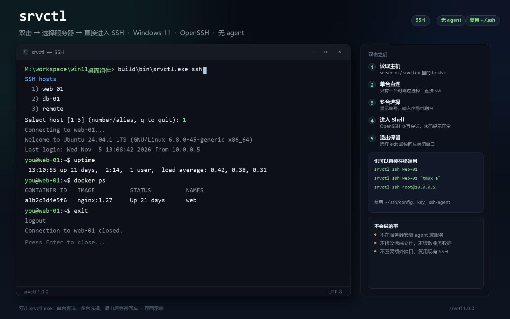
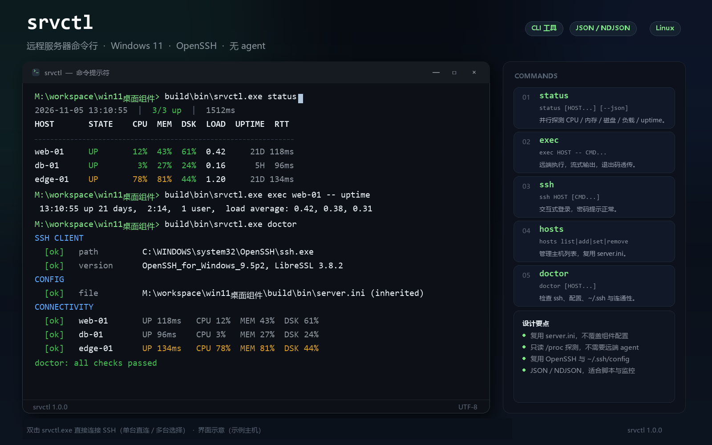

# srvctl（远程服务器命令行）

> 桌面端由 `desk.exe` 的 **Servers 卡片**承载，和 srvctl 共享 `server.ini`
> 与 `src/data/server/providers.cpp`；srvctl 的命令、配置和退出码不变。





srvctl.exe 是 Servers 卡片的命令行搭档。桌面板回答“现在怎么样”，
srvctl 回答“把这台机器写进脚本 / CI / 一次性命令里怎么用”。

两者共用同一套代码：src/data/server/providers.cpp 的 SSH 探测、错误分类，
以及 src/widget/proc.* 的 Windows 进程封装。因此状态值、/proc 探测脚本、
超时和 ssh 参数的含义完全一致，不会出现“组件显示 UP、命令行说 AUTH”的口径分裂。

- 不装 agent、不开新端口，复用 ~/.ssh/config、ssh-agent 和已有 key
- 探测只读（/proc、df），不需要 sudo
- exec 直接继承当前控制台，密码提示、流式输出、退出码都能正常工作
- 默认复用 server.ini 的主机列表，第一次编辑才创建自己的 srvctl.ini，
  不会改坏桌面板的位置和设置

## 快速开始

```bat
rem 先确认 ssh 本身能通（和 Servers 卡片的要求相同）
ssh web-01 "uname -sr"

rem 直接进入远程服务器（最常用）
build\bin\srvctl.exe ssh web-01

rem 不带 HOST：单台直连，多台弹出选择
build\bin\srvctl.exe ssh

rem 复用 server.ini 里的 hosts=，看状态
build\bin\srvctl.exe status

rem 或在命令行里临时指定目标
build\bin\srvctl.exe status web-01 root@10.0.0.5

rem 机器可读
build\bin\srvctl.exe status --json

rem 远程执行
build\bin\srvctl.exe exec web-01 -- uptime
build\bin\srvctl.exe exec --timeout 30 web-01 -- tail -n 50 /var/log/syslog

rem 登录
build\bin\srvctl.exe ssh web-01
```

srvctl.exe 是控制台程序：直接双击会连接 SSH——只有一台主机时直接进入，多台
时弹出编号选择；退出远程 shell 后按回车关闭窗口。其他命令请在 cmd 或
PowerShell 里带参数运行。Smart App Control 环境下不要用 .cmd / .bat 包装启动，
SAC 会拦截脚本宿主，直接双击 exe 即可。

第一次使用建议先跑 srvctl doctor：它会检查 ssh.exe、配置文件、~/.ssh 和
真实连通性，失败时给出可执行的下一步。

## 命令

### status

```text
srvctl status [HOST...] [--watch [SEC]] [--json] [--timeout SEC]
```

并行探测每台机器，输出 CPU / 内存 / 根分区磁盘 / 1 分钟负载 / uptime / 往返耗时。
不带 HOST 时使用配置里的 hosts=。单台超时不会拖慢其他机器。

```text
2026-11-05 03:08:30  |  2/3 up  |  1512ms  |  1 failed
HOST       STATE    CPU  MEM  DSK  LOAD  UPTIME  RTT   DETAIL
---------  -------  ---  ---  ---  ----  ------  ----  -----------------
web-01     UP       12%  43%  61%  0.42     21D  118ms
db-01      UP        3%  27%  24%  0.16      5H   96ms
10.0.0.9   TIMEOUT   --   --   --    --      --  2.0s  NO RESPONSE IN 2S
```

- --watch [SEC]：每 SEC 秒刷新（默认 5）。在真实控制台里清屏重画，Ctrl+C 退出；
  重定向到文件时按块追加，不会输出清屏控制符
- --json：单次输出一个 JSON 对象；和 --watch 一起用时每行一个对象（NDJSON）
- --timeout SEC：单台探测超时，覆盖配置里的 timeout（默认 8 秒）
- --ssh PATH / --key PATH：临时覆盖客户端和私钥
- --verbose：在表格下方显示实际 ssh 路径、配置路径和超时

退出码：全部在线 0；部分失败 3；全部失败 1；没有主机或找不到 ssh 4。
--watch 被 Ctrl+C 结束时报 0。

### exec

```text
srvctl exec [OPTIONS] HOST [--] COMMAND...
```

通过 ssh 在远端登录 shell 里执行命令。stdout / stderr 直接流到当前控制台，
ssh 的退出码原样成为 srvctl 的退出码（exit 7 就是 7），方便写脚本。

```bat
srvctl exec web-01 -- uname -a
srvctl exec web-01 "systemctl status nginx --no-pager"
srvctl exec --timeout 30 web-01 -- tail -n 50 /var/log/syslog
srvctl exec --tty db-01 -- htop
```

- 本地选项必须写在 HOST 之前；HOST 之后的所有词都会发给远端
- 默认加 -T（不分配伪终端），输出干净，适合管道和 CI
- --tty 强制 -t，给 htop、sudo 密码提示等需要终端的程序
- --timeout SEC 给本地 ssh 设上限，超时返回 124
- -v 把实际执行的 ssh 命令行打印到 stderr

远端命令的引号规则和 ssh host cmd args... 完全一样：ssh 会把多个参数用空格
拼起来交给远端 shell。需要保留分组时，把整条复合命令作为一个参数传入：

```bat
srvctl exec web-01 "for f in /etc/*.conf; do echo $f; done"
srvctl exec web-01 "sh -c 'exit 7'"
```

### ssh

```text
srvctl ssh [OPTIONS] HOST [CMD...]
```

打开交互式登录 shell，或在远端执行 CMD。和 exec 的区别是默认让 ssh 自己决定
是否分配终端，密码提示、全屏程序、tmux 都能正常工作。

```bat
srvctl ssh web-01
srvctl ssh web-01 "tmux attach || tmux new"
srvctl ssh --tty web-01
```

### hosts

```text
srvctl hosts list
srvctl hosts add TARGET...
srvctl hosts set TARGET...
srvctl hosts remove TARGET...
srvctl hosts clear
```

管理主机列表。TARGET 是 ~/.ssh/config 里的别名或 user@host[:port]，
空格 / 逗号 / 分号分隔，最多 32 个；Servers 卡片只显示前 8 个。

```bat
srvctl hosts                       rem 等价于 hosts list
srvctl hosts add web-01 db-01
srvctl hosts add root@10.0.0.5
srvctl hosts remove db-01           rem 也接受唯一的显示名，如 10.0.0.5
srvctl hosts set web-01 db-01
srvctl hosts list --json
```

remove 找不到目标时返回 1 并且不写文件；名字能匹配多台时要求写完整的
user@host。add 对已存在的主机是幂等的。

### doctor

```text
srvctl doctor [HOST...] [--timeout SEC]
```

逐项检查并给出建议：

1. ssh.exe 是否存在、ssh -V 能否运行
2. 配置文件、继承关系、hosts 数量、超时
3. ~/.ssh、config、known_hosts 和 id_* 私钥
4. 对每台目标做一次真实探测，失败时打印状态、原始 ssh 行和排查命令

全部通过返回 0，任意一项失败返回 1。

## 配置

### 查找顺序

1. --config PATH
2. 环境变量 SRVCTL_CONFIG
3. exe 同目录的 srvctl.ini
4. exe 同目录的 server.ini（只读继承）

server.ini 是 Servers 卡片的配置。它和 srvctl.ini 使用相同的 key=value 格式，
所以命令行第一次运行就能看到组件里已经配好的机器。**任何修改都不会写回
server.ini**：hosts add/set/remove/clear 会在 srvctl.ini 不存在时创建它，
并把继承到的 hosts / ssh / key / timeout 作为初值。Servers 卡片继续读自己的
server.ini，位置和设置不受影响。

### 格式

srvctl.ini 是 UTF-16（带 BOM）的 key=value，和组件的 ini 一致：

```ini
hosts=web-01, db-01, root@10.0.0.5
ssh=C:\Windows\System32\OpenSSH\ssh.exe
key=C:\Users\you\.ssh\id_ed25519
timeout=8
```

| 键 | 说明 |
|---|---|
| hosts | 逗号 / 分号 / 空格分隔，最多 32 个；- 开头的条目会被忽略 |
| ssh | 可选，指定 ssh.exe；留空则找系统 OpenSSH，再找 PATH |
| key | 可选，追加为 ssh -i <path>；用于 ~/.ssh/config 找不到 key 的情况 |
| timeout | 可选，探测超时秒数，默认 8 |

路径不要加引号（加了也会被去掉）。; 是值的一部分，不要写行尾注释。

## 输出与 JSON

status --json / hosts list --json 输出 UTF-8。status 的 schema：

```json
{
  "version": "1.0.0",
  "timestamp": "2026-11-05 03:08:30",
  "epoch": 1793819310,
  "elapsedMs": 1512,
  "timeoutSec": 8,
  "ssh": "C:\\Windows\\System32\\OpenSSH\\ssh.exe",
  "config": "M:\\workspace\\win11桌面组件\\build\\bin\\srvctl.ini",
  "configSource": "M:\\workspace\\win11桌面组件\\build\\bin\\server.ini",
  "inherited": true,
  "hosts": [
    {
      "target": "web-01",
      "name": "web-01",
      "ok": true,
      "state": "UP",
      "cpuPercent": 12,
      "memPercent": 43,
      "diskPercent": 61,
      "load1": 0.42,
      "cores": 8,
      "uptimeSec": 1845781,
      "rttMs": 118,
      "error": ""
    }
  ],
  "summary": { "total": 1, "up": 1, "failed": 0 }
}
```

- 未知的数值字段是 null（例如失败时的 cpuPercent），不是 -1
- error 是 ssh 的最后一条有效错误行，成功时为空字符串
- timestamp 是本地时间，epoch 是同一时刻的 Unix 秒，便于跨时区处理
- --watch --json 每行一个完整对象；直接 jq -c 或逐行 ConvertFrom-Json 即可
- 表格里的主机名最多显示 32 个字符；JSON 里始终是完整 target

颜色：默认只在真实控制台且支持 VT 时启用；NO_COLOR 环境变量和
--no-color 都会关闭，--color always 可以强制写进管道。CPU / 内存 / 磁盘
取最大值：绿 < 75%，黄 >= 75%，红 >= 90%。

## 退出码

| 码 | 含义 |
|---|---|
| 0 | 成功 |
| 1 | 失败：所有探测失败、doctor 发现问题、hosts remove 找不到目标、远端返回非 0 |
| 2 | 用法错误：未知命令 / 选项、缺少主机或命令、目标非法 |
| 3 | 部分主机探测失败 |
| 4 | 没有配置主机、显式指定的配置文件不存在、找不到 ssh 客户端 |
| 124 | exec / ssh 的 --timeout 到期 |

exec / ssh 把 ssh 的退出码原样返回；无法启动 ssh 时返回 127。

## 实现要点

- 探测直接调用 server::ProbeHost，和组件共用 providers.cpp；
  ssh -T -o BatchMode=yes ... sh -s 从 stdin 送入只读脚本
- exec 不加 BatchMode=yes，因此可以交互式输入密码 / key passphrase；
  默认 -T，--tty 时才申请伪终端
- 所有 ssh 调用都带 StrictHostKeyChecking=accept-new；首次连接会写
  known_hosts。额外带 UpdateHostKeys=no，避免已知主机每次连接都尝试
  回写 key 列表（只读 known_hosts 时尤其明显）
- exec / ssh 在控制台里临时把代码页切到 UTF-8，结束后恢复；重定向时
  直接输出 UTF-8 字节
- 进程封装在 src/widget/proc.*：捕获模式用管道 + 轮询超时，继承模式用
  DuplicateHandle 传递 stdio；两者都放进 kill-on-close 的 Job Object，
  超时或父进程退出时不会留下 ssh 子进程
- 颜色 / 表格 / JSON 在 src/cli/output.*；测试可脱离控制台运行

## 限制与排错

- 只支持 Linux 目标（依赖 /proc）；Windows / BSD 会显示 NO DATA
- 配置里最多 32 台，Servers 卡片只展示前 8 台
- --timeout 只结束本地 ssh；远端命令如果在忽略 SIGHUP 的情况下继续运行，
  需要远端自己的 timeout / systemd-run 兜底
- exec 的多个命令词会被 ssh 用空格拼成一个远端命令；复合命令请整体加引号
- 首次连接需要能写 known_hosts；配置目录只读时先手动 ssh 一次
- AUTH / TIMEOUT / DNS / REFUSED / HOSTKEY 的含义与
  [docs/server.md](server.md) 中的状态表一致
- Windows 11 Smart App Control 同样会拦截新构建的 srvctl.exe；运行
  powershell -ExecutionPolicy Bypass -File tools\sign-local.ps1 重签
- 旧版控制台的 UTF-8 支持取决于系统；Windows 10/11 的 conhost 和 Windows
  Terminal 都已验证

常用诊断：

```bat
srvctl doctor
srvctl status web-01 -v
srvctl exec -v web-01 -- uname -a
ssh -v web-01
```

## 测试

```bat
build.bat test
build\cli-test.exe
```

build\cli-test.exe 不联网，覆盖参数解析（含 --、--watch 可选值、
exec 选项边界）、目标去重 / 拒绝 -o...、CJK 宽字符表格、列收缩、
JSON 转义和配置读写，共 94 项检查。