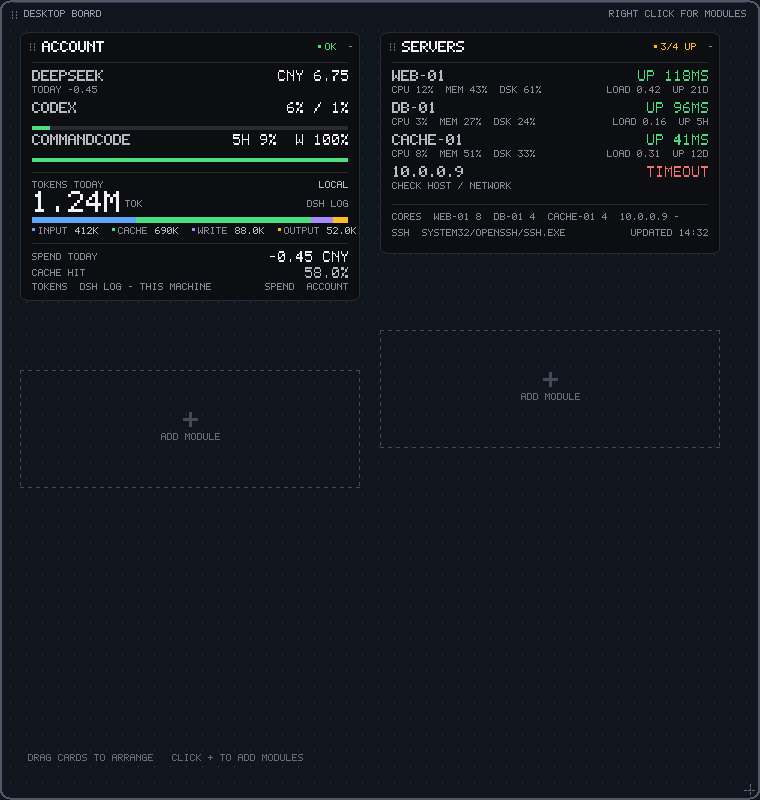

# Server Status（Servers 卡片 / 共享 SSH 探测）

> 桌面端由 `desk.exe` 的 **Servers 卡片**承载；旧 `server.exe` 已归档到
> `archive/standalone/server`，不再构建。本文的探测脚本、状态码、配置键仍然适用。
> 卡片交互见 [README](../README.md)：点标题条 `+` 展开内联详情，卡片菜单
> `SSH Hosts...` 改主机。

Servers 卡片通过 SSH 读取远程 Linux 机器的 CPU、内存、根分区磁盘、1 分钟负载和
uptime，每台一行；详情内联在卡片里。命令行版本（`srvctl`）见 [cli.md](cli.md)；
旧的 SSH Pad 已归档：[archive/docs/sshpad.md](../archive/docs/sshpad.md)。



## 为什么用 SSH

- **不用装 agent**：复用你已有的 `~/.ssh/config`、key、跳板机，不额外开端口
- **只读**：远端只读取 `/proc` 并运行 `df`，不写文件、不需要 sudo
- **一次往返**：连上后跑一段短脚本，1 秒采样 CPU，其余指标同一时刻取回
- **失败也看得见**：连接超时、认证失败、DNS、端口拒绝会显示不同状态，不会只留一个红点

## 要求

- Windows 10/11，带 OpenSSH 客户端（系统自带 `C:\Windows\System32\OpenSSH\ssh.exe`，
  或 `ssh.exe` 在 `PATH` 里）
- 目标机是 **Linux**（依赖 `/proc`），且 `ssh` 能免密登录
- 组件使用 `BatchMode=yes`，不会弹密码或私钥口令提示；不能免密就会显示 `AUTH`

## 快速开始

1. 先在 `cmd` 里确认别名能免密登录：

   ```bat
   ssh web-01 "uname -sr"
   ```

2. 启动桌面板：

   ```bat
   build\bin\desk.exe
   ```

3. 右键 **SERVERS** 卡片 → **SSH Hosts...**，输入 SSH 配置里的 `Host` 别名，或用
   `root@10.0.0.5` 这种直接目标，多个用逗号分隔：

   ```
   web-01, db-01, root@10.0.0.5
   ```

   最多 8 台。输入 `-` 回车可清空。

4. 卡片每 30 秒刷新一次（8 秒超时，多台并行探测）；点标题条 `+` 展开内联详情。

## 界面说明

主面板每台服务器两行：

```text
EDGE-01                              UP 120MS
CPU 12%  MEM 26%  DSK 24%     LOAD 0.00  UP 21D
```

| 位置 | 含义 |
|---|---|
| 左侧名称 | SSH 目标的 `user@` 之后部分，最多 16 字符 |
| 右侧 `UP 120MS` | 在线；数字是整次 SSH 探测的往返耗时（连接 + 认证 + 脚本） |
| `CPU / MEM / DSK` | CPU 使用率、内存使用率、根分区使用率 |
| `LOAD / UP` | 1 分钟负载、uptime（`21D` / `5H` / `42M`） |
| 颜色 | 取 CPU / MEM / DSK 最大值：绿 `< 75%`，黄 `>= 75%`，红 `>= 90%` |

探测失败时：

```text
DB-03                                     TIMEOUT
CHECK HOST / NETWORK               NO RESPONSE IN 8S
```

| 状态 | 含义 |
|---|---|
| `TIMEOUT` | 8 秒内没有完成探测（网络、安全组、防火墙） |
| `AUTH` | 认证失败：key 不对、用户不对、sshd 没开 publickey |
| `DNS` | 主机名/别名无法解析 |
| `REFUSED` | 22 端口没开或 sshd 没运行 |
| `HOSTKEY` | 主机指纹变化，或 known_hosts 不可写 |
| `UNREACH` / `CLOSED` | 没有路由 / 对端主动断开 |
| `NO SSH` | 本地找不到 `ssh.exe` |
| `NO DATA` | 能登录，但没有 `/proc`（不是 Linux）或输出无法解析 |

展开详情会补充失败原因、CORES、SSH 客户端路径和更新时间，不重复行内已显示的
CPU / MEM / DSK / LOAD / UP。

## 快捷键

| 操作 | 说明 |
|---|---|
| 点标题条 `+` / `-` | 展开/收起内联详情 |
| 拖卡片标题条 | 移动 Servers 卡 |
| 右键卡片 | SSH Hosts... / Refresh / Remove card |
| `Ctrl+Alt+R` / `D` / `Q` | 刷新全部 / 全部详情 / 退出 |
| 托盘右键 | Add module / Tidy / Refresh / Start with Windows / Exit |

板的位置和卡片位置存在 `desk.ini`；`server.ini` 只保存 SSH 主机配置。

## 配置

配置文件是 exe 同目录的 `server.ini`（UTF-16，key=value），由 Servers 卡片和
`srvctl` 共同维护：

```ini
hosts=web-01, db-01
ssh=
key=
timeout=8
```

| 键 | 说明 |
|---|---|
| `hosts` | 逗号 / 分号 / 空格分隔的 SSH 目标，最多 8 个；`-` 开头的条目会被忽略 |
| `ssh` | 可选，指定 `ssh.exe`；留空则依次找 `%SystemRoot%\System32\OpenSSH\ssh.exe`、`PATH` |
| `key` | 可选私钥路径，追加为 `-i <path>`；用于 `~/.ssh/config` 无法正确找到 key 的情况 |
| `timeout` | 可选，探测超时秒数，默认 8 |

字符串值里的 `;` 是值的一部分，不要写行尾注释；注释请单独占一行且不含 `=`。

卡片的 `SSH Hosts...` 只编辑 `hosts`。`ssh` / `key` 需要直接编辑 ini，下一次
刷新（30 秒定时或卡片 Refresh）生效；`hosts` 也由 `srvctl hosts` 共享。
卡片位置在 `desk.ini` 的 `card.servers.x/y`，不要写到 `server.ini`。

> **Windows OpenSSH 的路径坑**：`~/.ssh/config` 里如果写的是 Git Bash 风格的
> `/c/Users/you/.ssh/id_ed25519`，Windows 自带的 `ssh.exe` 找不到它，会表现为
> `AUTH`。把路径改成 `C:/Users/you/.ssh/id_ed25519`（或 `~/.ssh/...`），
> 或者设置上面的 `key` / `ssh`（指向 Git 的 `usr\bin\ssh.exe`）。

## 探测脚本

远端执行的就是下面这段 POSIX `sh`，通过 `ssh ... <host> sh -s` 从 stdin 送入。
所有命令都有 `2>/dev/null` 兜底，任何一项缺失都不会让整次探测失败：

```sh
LC_ALL=C
echo "LOAD=$(cut -d' ' -f1 /proc/loadavg 2>/dev/null)"
echo "CORES=$(nproc 2>/dev/null || getconf _NPROCESSORS_ONLN 2>/dev/null)"
echo "MEMT=$(awk '/^MemTotal:/{print $2}' /proc/meminfo 2>/dev/null)"
echo "MEMA=$(awk '/^MemAvailable:/{print $2}' /proc/meminfo 2>/dev/null)"
echo "DSK=$(df -P / 2>/dev/null | awk 'NR==2{gsub(/%/,"",$5); print $5}')"
echo "UP=$(cut -d. -f1 /proc/uptime 2>/dev/null)"
if read -r _ u n s i w irq sirq st _ < /proc/stat 2>/dev/null; then
  t1=$((u+n+s+i+w+irq+sirq+st)); i1=$((i+w))
  sleep 1
  if read -r _ u n s i w irq sirq st _ < /proc/stat 2>/dev/null; then
    t2=$((u+n+s+i+w+irq+sirq+st)); i2=$((i+w))
    if [ "$t2" -gt "$t1" ]; then
      echo "CPU=$((100*(t2-t1-i2+i1)/(t2-t1)))"
    fi
  fi
fi
```

- `MEM% = (MemTotal - MemAvailable) / MemTotal`
- `CPU%` 是 1 秒窗口内的非 idle 占比；拿不到就显示 `--`，不影响其他指标
- 脚本没有写操作；`df` 统计的是 `/`

主机名、端口、用户、跳板机都在 `~/.ssh/config` 里配置，组件只传目标名。

## Windows Smart App Control 与本地签名

Windows 11 开启 Smart App Control 时，`build.bat` 新生成的未签名 exe 会被拦截：

```text
An Application Control policy has blocked this file
```

用当前用户的自签名代码签名证书签名后即可运行（本机已验证）：

```bat
powershell -ExecutionPolicy Bypass -File tools\sign-local.ps1
build\bin\desk.exe
```

脚本会：

- 在 `Cert:\CurrentUser\My` 里查找或创建一张
  `CN=Win11 Desktop Widgets (Local)` 的 code-signing 证书
  （首次生成，3 年有效，私钥不出本机）
- 签名 `build\bin\*.exe`、`build\*-test.exe`
- 不需要管理员权限、不上传任何东西
- 证书链是自签名，所以 `Get-AuthenticodeSignature` 显示 `UnknownError` 是正常的，
  SAC 仍会放行

`build.bat` 每次重新链接都会覆盖签名，所以**每次构建后都要重签**。签名后的实际运行：


如果签名后仍被拦截，只能关闭 SAC（设置 → 隐私和安全性 → Windows 安全中心 →
应用和浏览器控制 → 智能应用控制；关闭后要重置/重装 Windows 才能再开启），
或改用受信任 CA 签发的代码签名证书。

## 排错

| 现象 | 处理 |
|---|---|
| `AUTH` | `ssh -v <host>` 看是否用的预期 key；检查 `User` / `IdentityFile` |
| `TIMEOUT` | 在 cmd 里直接 `ssh <host>`；检查安全组 / 防火墙 / 端口 |
| `HOSTKEY` | 先手动 ssh 一次接受指纹；确认指纹变化可信后 `ssh-keygen -R <host>` |
| `NO SSH` | 安装 OpenSSH Client，或在 ini 里设 `ssh=` 指向可用客户端 |
| `NO DATA` | 目标不是 Linux，或 `/proc` 不可读；Windows / BSD 不支持 |
| 一直是 `WAIT` | 探测还没回来；8 秒后会变成结果状态，卡片 Refresh 可重试 |
| 首次连接失败但手动能连 | 组件用 `accept-new` 写 `known_hosts`；配置目录只读会失败，先手动连一次 |

组件不做端口转发、不读取业务文件、不上传任何数据；所有连接都来自本机的
`ssh` 进程。

## 测试

```bat
build.bat test
```

`build.bat test` 不联网，运行 render / board layout / desk render / cli；旧的
`server-test.exe` 随旧 Server 组件归档。共享的主机解析、`/proc` 解析、错误分类
和行布局由 `desk-render-test`（Servers 卡片视图）和 `cli-test` 覆盖；真实 SSH
探测由 `srvctl doctor` / `srvctl status` 验证。产物是
`build\desk-board-preview.bmp` 和 `build\preview.bmp`。

在开启 SAC 的机器上，`build.bat test` 会先给测试 exe 签名再运行；如果证书创建
失败，先手动运行 `tools\sign-local.ps1`。
